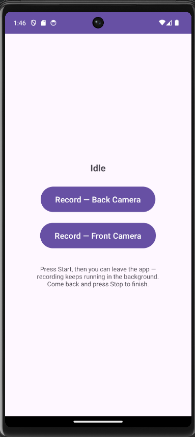
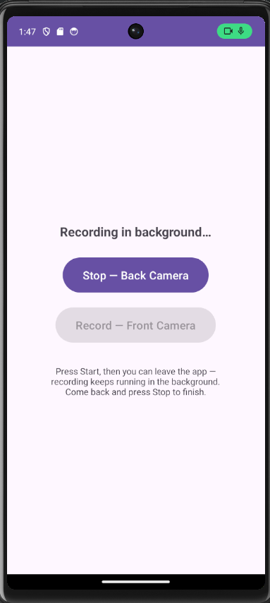
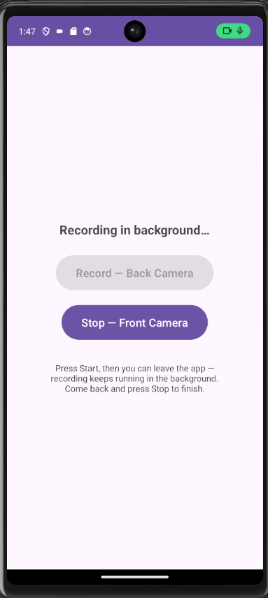
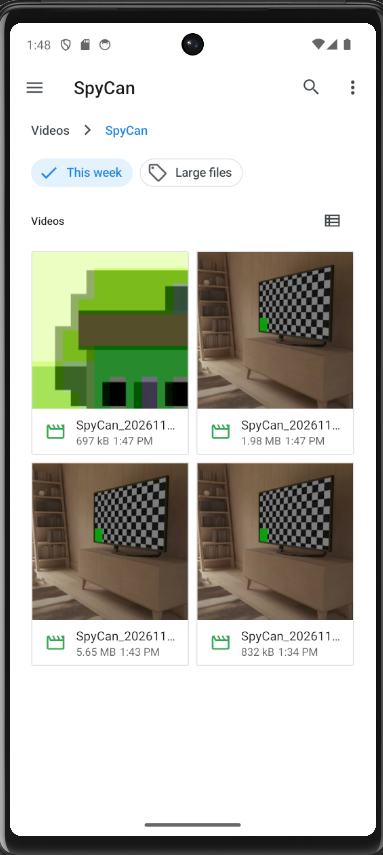

# SpyCam

**Record in silence.** SpyCam is an Android app that records video in the background — with no on-screen camera preview — and saves the clips to shared storage.

## Features

- Two buttons, one per lens (back / front). Tap one to start recording; it turns into a stop button while the other lens stays disabled.
- No camera preview: recording runs in a foreground service, so you can leave the app and it keeps going.
- Audio is recorded when the microphone permission is granted; otherwise video only.
- Clips are saved to `Movies/SpyCam` (via `MediaStore` on Android 10+).
- A persistent notification is shown while recording, as required by Android for camera foreground services.

## Screenshots

<p>
  
  
  
  
</p>

## Requirements

- Android 8.0 (API 26) or newer
- A device with at least one camera
- JDK 17 and the Android SDK (compile/target SDK 34) to build from source

## Permissions

| Permission | Why |
| --- | --- |
| `CAMERA` | Capture video |
| `RECORD_AUDIO` | Optional; record audio with the video |
| `FOREGROUND_SERVICE` (+ `_CAMERA`, `_MICROPHONE`) | Keep recording while the app is in the background |
| `POST_NOTIFICATIONS` | Show the recording notification |
| `WRITE_EXTERNAL_STORAGE` (API ≤ 28 only) | Save clips to shared storage on old devices |

## Build and run

```bash
./gradlew assembleDebug     # APK in app/build/outputs/apk/debug/
./gradlew installDebug      # install on a connected device or emulator
```

Release builds are signed only if a `keystore.properties` file exists at the repo root; otherwise they are produced unsigned.

## Development

| Task | Command |
| --- | --- |
| Format | `./gradlew ktlintFormat` |
| Static analysis | `./gradlew detekt lintDebug` |
| Unit tests | `./gradlew testDebugUnitTest` |
| Coverage report | `./gradlew koverHtmlReportDebug` |
| Full build + checks | `./gradlew build` (enforces ≥ 80% coverage) |

## Architecture

Code lives in `app/src/main/java/com/tk/spycam/`, with the logic in small testable classes and thin Android glue.

- **UI:** `MainActivity`, `MainViewModel`, `RecordingControls` — permissions, button taps, and rendering the recording state.
- **Service:** `RecordingService` is a `LifecycleService`, which lets CameraX record without a preview.
- **Recording logic:** `RecordingSession` drives a `CameraRecorder` (implemented by `CameraXRecorder`) and emits outcomes.
- **State:** `RecordingStateHolder` exposes a `StateFlow` of `Idle` / `Recording(lens)` shared by the UI and the service.

Built with Kotlin, CameraX, Coroutines/Flow and Timber. Tests use JUnit 5, MockK and Turbine. See [CLAUDE.md](CLAUDE.md) for deeper notes and project conventions.

## Responsible use

Recording people without their knowledge or consent is illegal in many places. Use SpyCam only where you have the right to record, and follow your local laws.
